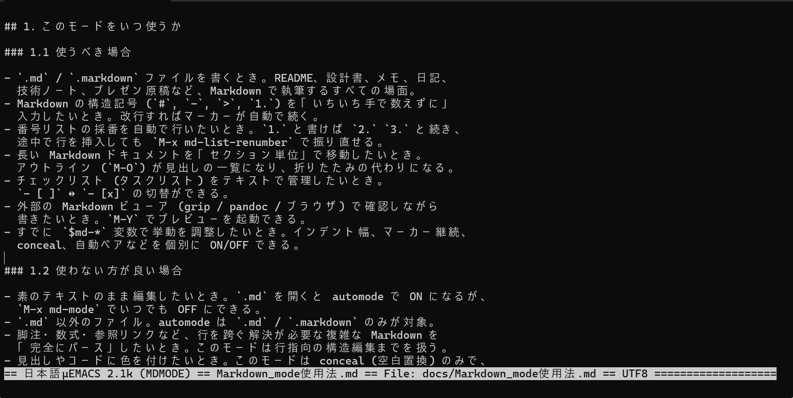
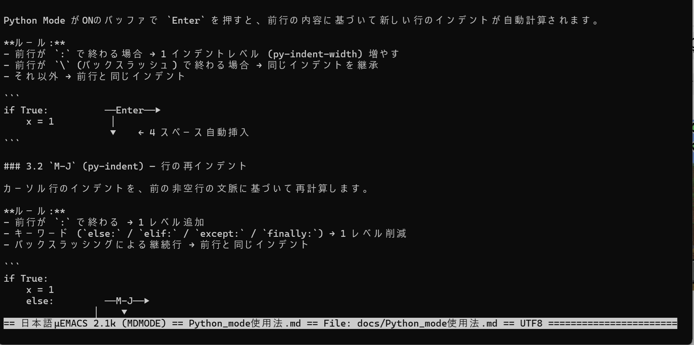

# kemacs Rust 版

kemacs は、Daniel M. Lawrence 氏が 1987 年にリリースした軽量テキストエディタ
MicroEMACS 3.8i をベースに、Takanori (sanewo) Saneto 氏による日本語 (漢字) 拡張を
施したエディタです。このリポジトリはその Rust 移植版で、Rust 単体でビルド・
実行・テストできます。元の C 版ソースと C のビルド・テストは別リポジトリで
管理しています。

## スクリーンショット

### Markdown Mode



行頭マーカーの自動継続、番号リストの採番、アウトライン、conceal、
外部プレビューに対応します。

### Python Mode



改行時の自動インデント、`M-J` による再インデント、`Backspace` による
デデントを提供します。

## ビルド・実行

```sh
cargo build                       # target/debug/kemacs を生成
cargo run -- file.txt             # ファイルを開いて編集 (符号化方式は自動判定)
cargo run -- --code SJIS new.txt  # SJIS の新規ファイルとして開く
cargo run -- -v file.txt          # C 版互換のオプションも使用可
```

`--code` はファイル引数より前に置いてください (`UTF8`, `SJIS`, `UJIS`, `JIS`
等)。改行種別は `CRLF/UTF8` のように `/` で指定します。

## リリースビルドとインストール

```sh
cargo build --release            # target/release/kemacs を生成 (最適化ビルド)
cargo install --path .           # ~/.cargo/bin/kemacs に配置
cargo install --locked --path .  # Cargo.lock の依存バージョンを固定して配置
```

`cargo install` の配置先は `~/.cargo/bin` です。そこが `$PATH` に含まれていれば、`kemacs file.txt` で起動できます。別の場所へ入れる場合は `--root` を指定します。

```sh
cargo install --root /usr/local --path .   # /usr/local/bin/kemacs へ配置
```

更新と削除:

```sh
cargo install --force --path .   # 上書き再インストール
cargo uninstall kemacs           # 削除
```

GitHub リポジトリ登録後は、リモートから直接インストールできます。

```sh
cargo install --git https://github.com/NIWA-Hideyuki/kemacs_rust.git --locked
```

crates.io への `cargo publish` は行わないでください。LICENSE が非商用制約を含むためです。

## テスト

```sh
cargo test
cargo clippy --all-targets -- -D warnings
```

## 主な機能

- UTF-8 / EUC-JP / Shift_JIS / JIS の読み書き (iconv)。未編集ファイルは
  元バイト列をそのまま保存し、表現不能文字は `KEMACS-U+XXXX;` として
  可逆的にエスケープ。
- Emacs 風キーバインド、`C-X` / `M-` / `C-U` プレフィックス、キー再バインド、
  キーボードマクロ、名前付きプロシージャ / スクリプト言語。
- MAGIC 正規表現、全角文字の大小文字無視、インクリメンタルサーチ、
  置換、undo / redo。
- C Mode / Python Mode / Markdown Mode の自動インデント、Markdown conceal、
  外部プレビュー、行番号ガーター、カラー表示。
- SGR 1006 マウス (ドラッグ選択・ダブルクリック・ホイール)、差分描画、
  リサイズ時の全描画。
- シェル実行、autosave、パスワード非エコー入力、C 互換の弱暗号と
  XChaCha20-Poly1305 + PBKDF2 の強暗号。

## ドキュメント

- [`docs/kemacs使用手引書.md`](docs/kemacs使用手引書.md) — キー操作・設定・コマンドの総合手引書
- [`docs/Rust移植.md`](docs/Rust移植.md) — 実装範囲・未移植項目・ビルド方法
- [`docs/rust版とC言語版の違い.md`](docs/rust版とC言語版の違い.md) — 使い方・外観の比較
- [`docs/all_test_item_list.md`](docs/all_test_item_list.md) — `cargo test` の全142件のテスト項目
- [`docs/cmode使用法.md`](docs/cmode使用法.md) — C Mode
- [`docs/Python_mode使用法.md`](docs/Python_mode使用法.md) — Python Mode
- [`docs/Markdown_mode使用法.md`](docs/Markdown_mode使用法.md) — Markdown Mode
- [`docs/markdown仕様書.md`](docs/markdown仕様書.md) — Markdown Mode の仕様
- [`docs/WSL2でCtrl+Vを使えるようにする.md`](docs/WSL2でCtrl+Vを使えるようにする.md) — WSL2 での Ctrl+V 設定

## 著作権

| 著作権者                       | モジュール                                  |
|--------------------------------|---------------------------------------------|
| Daniel M. Lawrence (1958-2010) | MicroEMACS 3.8i コアエディタ                |
| Takanori (sanewo) Saneto       | kemacs 日本語 (漢字) 拡張                   |
| Naoyuki Niide                  | kemacs 非公式パッチ                         |
| Dana L. Hoggatt                | crypt.c 暗号化ルーチン                      |
| Hideyuki Niwa                  | UTF-8 対応・Rust 移植                       |

## ライセンス

kemacs は非商用目的に限り自由にコピー・配布可能な元ライセンスのまま
配布されています。商用ソフトウェアへの組込みや再販は、すべての著作権者の
事前許可を得る必要があります。詳細は [`LICENSE`](LICENSE) を参照してください。
